

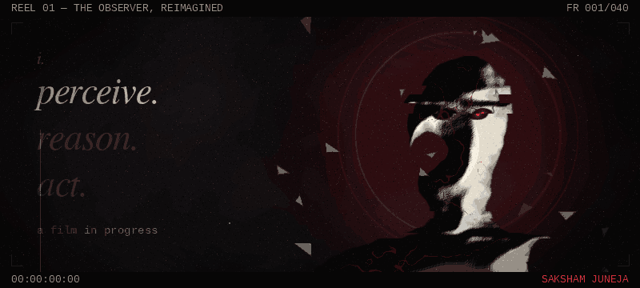
 
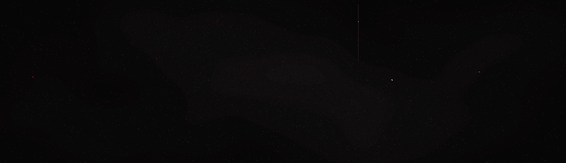
 
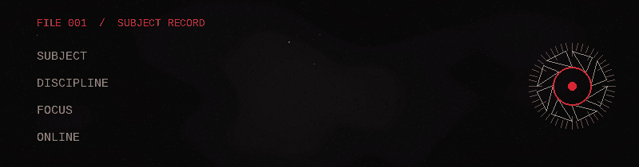
 
<a href="https://github.com/SakshamJuneja007">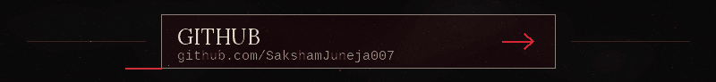</a>
 
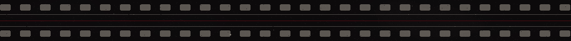
 

 
<a href="https://github.com/SakshamJuneja007/freaky-monkey">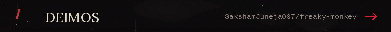</a>
 
<a href="https://github.com/SakshamJuneja007/freaky-monkey">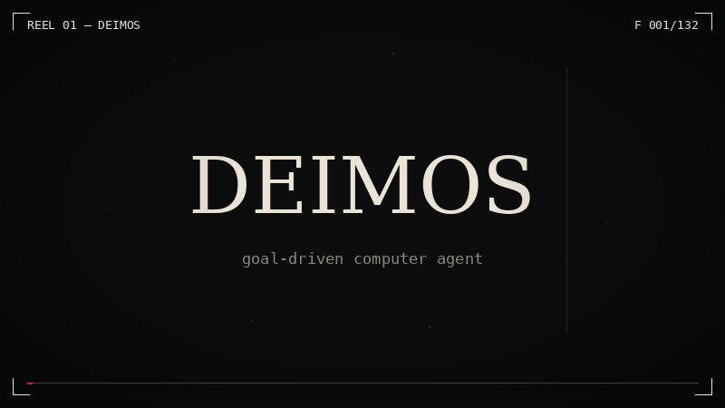</a>
 
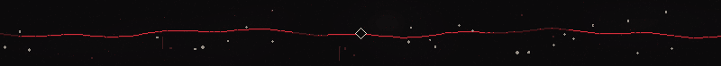
 
<a href="https://github.com/SakshamJuneja007/Chess-ai">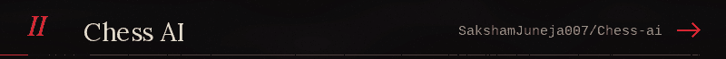</a>
 
<a href="https://github.com/SakshamJuneja007/Chess-ai">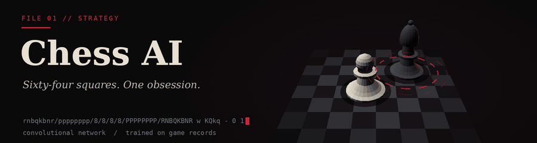</a>
 

 
<a href="https://github.com/SakshamJuneja007/TAI-Tekken-AI-Motion-Control-System">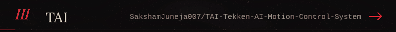</a>
 
<a href="https://github.com/SakshamJuneja007/TAI-Tekken-AI-Motion-Control-System">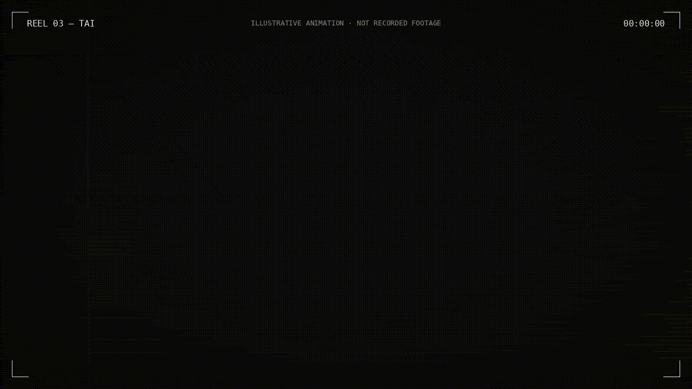</a>
 

 
<a href="https://github.com/SakshamJuneja007/saksham-persona">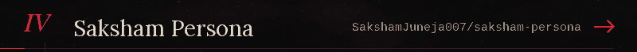</a>
 

 

 
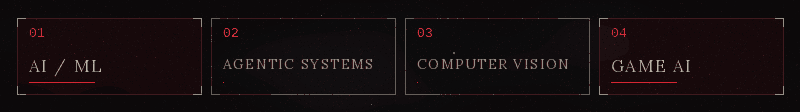
 

 

